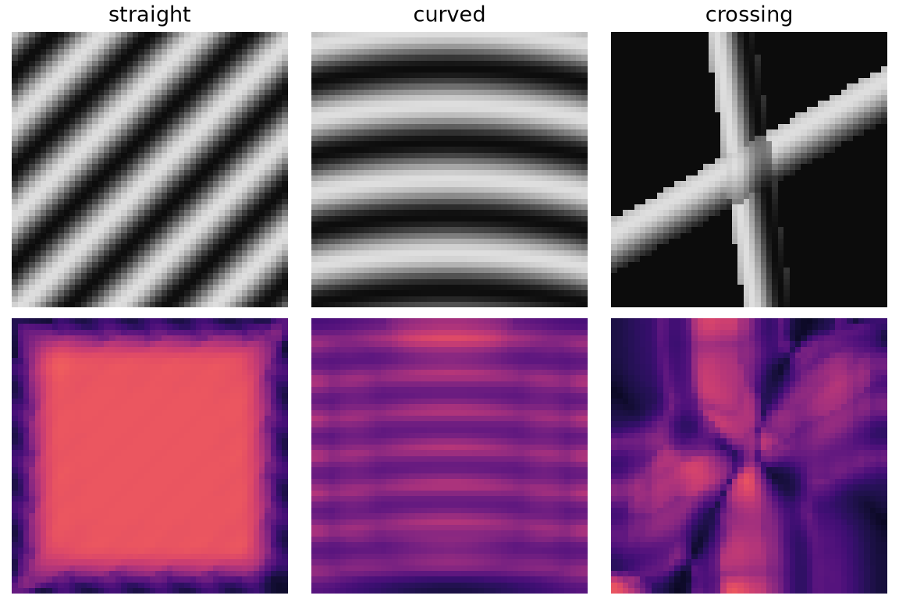

# StructField-Vision

StructField-Vision 1.0.0 estimates validated probabilistic structural fields
from grayscale or RGB images. The stable core exposes orientation probability,
frequency moments, coherence, scale evidence, and a clearly labelled heuristic
uncertainty baseline without requiring checkpoints or external data.

```bash
pip install structfield-vision==1.0.0
```

The supported v1 platform is Linux x86_64 with Python 3.11. The source tree can
also be installed locally with `pip install .`. Visualization is optional:
`pip install 'structfield-vision[visualization]==1.0.0'`.

```python
import torch
from structfield import AnalyticStructuralFieldEstimator

image = torch.rand(2, 3, 96, 128)
field = AnalyticStructuralFieldEstimator()(image)
modes = field.topk_orientations(k=2)

print(field.orientation_prob.shape)  # [2, 16, 96, 128]
print(modes.angles.shape)  # [2, 2, 96, 128]
```

`orientation_prob` is the sole orientation state. Modes are derived on demand,
so stored angles cannot drift away from their probability distribution. Angles
are axial radians in `[0, π)`, positive counter-clockwise in displayed image
coordinates; frequency is cycles/pixel and scale is pixels.

Stable top-level objects are `StructuralField`, `FieldMetadata`,
`OrientationModes`, `ValidationMode`, the analytic estimator APIs, packaged
configuration readers, and safe checkpoint APIs. Stable domain modules are
`core`, `benchmarks`, `metrics`, `configs`, `datasets`, `checkpoint`, `cli`, and
`visualization`. Research adapters, corruption/equivariance/reliability tools,
the heuristic uncertainty baseline, and reference applications are labelled
under `structfield.experimental`.

## CLI

```bash
structfield-estimate --input image.png --output estimate --device cpu
```

The CLI publishes an immutable `structfield-estimate-v1` generation and an
atomic `current.json` pointer. Each numeric output, including the full
`orientation_probability.npy`, is recorded with size and SHA-256. The resolver
rejects symlinks, undeclared files, schema mismatches, and integrity failures.

## Scope and evidence

The repository distributes no dataset, pretrained weights, clinical tables, or
historical checkpoint. All examples and README visuals are synthetic. The
benchmark remains `StructField-Bench-v0.1`, a format supported by software v1;
its deterministic release baseline is not a performance claim.

See the [documentation](docs/index.md), [migration guide](docs/migration-0.3.md),
[limitations](docs/limitations.md), [provenance](docs/legal/CODE_PROVENANCE.md),
and [license scope](docs/legal/LICENSE_SCOPE.md). This local release process
does not push, publish to PyPI, or create a hosted release.


